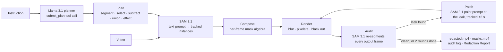

# Veil

**Redact video from a plain-English instruction, then check the result.**

> "Blur every face except the woman in the pink coat."

**Live demo:** https://atharva283--veil-demo-web.us-east.modal.run (replays of recorded runs, see below)
**Demo video:** added at submission

Built for the Meta Global AI Developer Hackathon, Indie Developer track. Built with Llama.

---

## Why

Most people with a phone have footage they can't share: a street full of strangers, a desk with a readable inbox, a meetup where someone's badge shows their name. Blur tools give you two choices. You can blur everything automatically, or you can mask by hand, frame by frame. Neither handles what people actually need: *everyone except her*, *the plate on that car*, *also the phone*. And none of them tells you when it missed something.

Veil takes the instruction in plain English. **Llama 3.1** turns it into a plan. **SAM 3.1** finds and tracks every instance. Then SAM 3.1 checks Veil's own output, frame by frame, and Veil patches what slipped through. Anything it can't fix is flagged with a timestamp for a person to review. Every run ends with a tamper-evident report.

Who it's for: creators and journalists publishing street footage, schools and event organisers sharing recordings, and anyone answering a records request for bodycam or CCTV footage.

## Try it

Open the [live demo](https://atharva283--veil-demo-web.us-east.modal.run), pick a clip, and press **Redact video**:

1. **The plan** appears as numbered tool calls. **Show tool call** shows Llama's raw `submit_plan` JSON.
2. **Drag the veil** across the frame to compare the original and the redacted video. **Masks** shows SAM's tracked instances.
3. **The audit log** lists every tracked object as *verified*, *patched by the audit*, *kept visible* or *flagged for review*. Click a row to jump to that moment.
4. **Apply the follow-up** ("Also hide the bank logo."). It reuses every earlier track and segments only the new concept.
5. **Report** opens the Redaction Report.

**About the demo:** the site replays runs recorded on a GPU with Llama 3.1 8B and SAM 3.1 (Colab T4, Oct 27). It doesn't run models while you watch. That's why the clips and their instructions are fixed, and the top bar marks each model *recorded*. To run Veil on your own footage, see [Run it yourself](#run-it-yourself).

## How it works



| Plan step | Meaning |
|---|---|
| `segment(concept)` | SAM 3.1 text prompt, e.g. `"face"`, `"pink coat"` → tracked instances |
| `select(A, B)` | instances of A that overlap B, frame by frame (the person wearing the pink coat) |
| `subtract(A, B)` | instances of A that don't overlap B (faces except hers) |
| `union(A, B, …)` | merge instance sets |
| `effect(A, blur\|pixelate\|blackout\|highlight)` | render over every instance of A |

Llama's actual plan for the demo instruction:

```
s1 segment("face")   s2 segment("person")   s3 segment("pink coat")
s4 select(s2, s3)            → the woman in the pink coat
s5 subtract(s1, s4)          → faces except hers
s6 effect(s5, blur)
```

Selections and exceptions are evaluated **per frame**, not per track. So when she walks behind someone, or another face passes in front of hers, only the frames where she is actually inside the exception stay visible.

## How Veil uses Meta's models

- **Llama 3.1 8B: the planner.** One forced `submit_plan` tool call over an OpenAI-compatible endpoint (Ollama on the same T4 as SAM). The plan is validated against a schema and a step graph. One repair round feeds the validation error back to Llama. A plan that still fails falls back to a rule-based planner, and the run is labelled as such; the cache refuses to keep it.
- **SAM 3.1: the segmenter *and* the auditor.** Veil uses SAM 3.1's video predictor three ways:
  1. **Text prompts track every concept** in the plan.
  2. **SAM re-segments the rendered output.** Any target still more than 20% visible counts as a leak. Using the segmenter to check its own output is the key idea: a miss in the first pass is often found on the second, at a lower threshold, on the edited frames.
  3. **A point prompt at each leak** is tracked two seconds either way to patch it.
- **Muse Spark** (`backend/app/auditor/muse_spark.py`) is integrated as an optional second auditor that looks at sampled frames. The recorded runs don't use it: the Meta Model API needed an international credit card we didn't have. It works with any OpenAI-compatible vision endpoint, such as Muse Spark Open on Baseten.

## Results

Measured on the recorded runs in [`demo_assets/cache/`](demo_assets/cache/). Each run's `audit.json` has the per-object log.

| Clip and instruction | Planner | Frames re-checked by SAM | Misses caught and re-segmented | Flagged for a person |
|---|---|---|---|---|
| Manchester street: "Blur every face except the woman in the pink coat." | Llama 3.1 8B | 397 / 397 | 4 ¹ | 14 ¹ |
| … follow-up: "Also hide the bank logo." | Llama 3.1 8B | 397 / 397 | 16 | 12 |
| Desk: "Black out the laptop screen." | Llama 3.1 8B | 199 / 199 | 0 | 1 |
| … follow-up: "Also black out the phone." | Llama 3.1 8B | 199 / 199 | 0 | 1 |

¹ In this run, a leak on the clip's last frame crashed SAM's backward pass, so that round's patches were never made. That bug is fixed (`refine` now runs only the direction that has frames, and isolates each request); the follow-up run shows the patch loop working. The recorded run is published as it happened.

**What "flagged" means:** SAM still finds part of a target in that frame (typically 60–80% hidden), and re-segmenting didn't produce a track. The report lists the timestamp, and a person decides. One flag in the follow-up is the woman in the pink coat herself, a false alarm the reviewer dismisses.

**Planner evaluation** (`python -m app.planner.eval`). There are 14 instructions with known correct plans, including the demo instructions, two follow-up edits, and hard cases ("but not the child holding the red balloon", "only the license plate on the red car"). Each plan is scored for validity and for meaning: the right effect on each target, exceptions subtracted where they apply and nowhere else, selections kept, nothing invented.

| Planner | Valid | Correct |
|---|---|---|
| Rule-based fallback | 14 / 14 | 11 / 14 |

**Speed on a free Colab T4:** about 1 frame per second per concept for SAM 3.1. The Manchester clip has 397 frames and 3 concepts: segmentation took 19 minutes, and the full run with two audit rounds took 75 minutes. A run that's been recorded replays instantly.

## The Redaction Report

Each run writes `report.html` and `report.json`. They list every object, its status, and a thumbnail of each patch. They also hold a SHA-256 hash chain over the original clip, the plan, the redacted video, the masks video and the audit log:

```
link_0 = sha256("veil-report-v1")
link_i = sha256(link_{i-1} + name_i + sha256(file_i))
```

Change one byte in any artifact and verification fails:

```bash
cd backend
.venv/Scripts/python -m app.report verify ../demo_assets/cache/df14e93c192b --original ../demo_assets/clips/manchester_street.mp4
```

The chain is tamper-evident, not signed. It shows the files are the ones the run produced; it doesn't certify compliance with any privacy law.

## Engineering notes: SAM 3.1 on a free T4

SAM 3.1 targets Ampere and newer GPUs with plenty of memory. Running it on a 15 GB T4 took these changes, all in [`sam3_core.py`](backend/app/segmenter/sam3_core.py) and covered by tests against a fake predictor:

- **No bf16 on a T4.** `set_precision` rewrites the installed package's 22 hard-coded `torch.bfloat16`s to fp16 (or fp32) before import. It also lets SAM's Flash-only attention fall back to the memory-efficient kernel, which a T4 supports.
- **Memory:**
  - Each frame's full-resolution masks are dropped once they've been streamed.
  - Tracker state older than 48 frames is pruned; SAM looks back 7 frames for memory and 16 for object pointers.
  - The detector runs on 4-frame batches instead of 16. One 16-frame batch alone needs 1.27 GiB.
  - Peak usage on the T4 is 8.7 GiB.
- **RAM:** SAM decodes a whole clip as float32 at 1008×1008, about 12 MB per frame. Long clips are tracked in 150-frame pieces that share a boundary frame, and objects are joined across the seam by box overlap.
- **Upstream bugs worked around:**
  - `start_session` passes an argument the SAM 3.1 model rejects.
  - A forward pass from a clip's last frame leaves the backward pass reading results that were never computed.

## Run it yourself

**Offline, no keys.** Every model runs as a local mock, including a simulated miss for the audit to catch:

```powershell
scripts\setup.ps1      # Windows
scripts\dev.ps1        # open http://localhost:5173
```

```bash
scripts/setup.sh       # macOS / Linux
scripts/dev.sh
```

Pick **Market Street crossing** (synthetic, labelled "simulated detections") and press **Redact video**. Requires Python 3.11+ and Node 20.19+; ffmpeg comes with `imageio-ffmpeg`.

**With SAM 3.1 and Llama 3.1 on a free GPU.** Open [`notebooks/veil_colab_runner.ipynb`](notebooks/veil_colab_runner.ipynb) in Colab:
- choose a T4 runtime;
- add a Hugging Face token with access to `facebook/sam3.1` as the Colab secret `HF_TOKEN`;
- run the cells in order.

The notebook checks SAM on 240 frames, runs the instructions, freezes each run into `demo_assets/cache/`, and zips it for download.

**Replay mode, as deployed.** Set `VEIL_CACHE_ONLY=1` to serve frozen runs only: no uploads and no model calls. `modal deploy backend/modal_app/web.py` builds the frontend's `dist/` into a single CPU container on Modal.

Configuration lives in [`.env.example`](.env.example). Every integration is optional and falls back to its mock.

**Tests:** `cd backend && .venv/Scripts/python -m pytest` (53 tests). They cover:
- the planner grammar and the evaluation's checker;
- mask algebra and RLE;
- end-to-end runs on the synthetic clips;
- the SAM 3.1 wrapper against a fake predictor (pieces, pruning, edge frames, precision rewrite);
- the hash chain and tamper detection;
- replay mode.

## Limitations

- **Visual only.** Spoken names in the audio aren't redacted.
- **No text recognition.** Veil hides objects such as screens, plates and badges, not individual words on them.
- **The planner is an 8B model.** It's fast and runs on the same GPU as SAM, but it doesn't always produce a valid plan. Every fallback is labelled, and recorded runs never include one.
- **Speed.** About 1 frame per second per concept on a T4. An A10G or better is several times faster; `backend/modal_app/sam3_service.py` is that deployment, ready but not used for the recorded runs.
- **Small, distant faces** can be missed by both passes. The audit catches many, not all, so the report's flags exist for a person to review.

## Project layout

```
backend/app/
  main.py              API, static files, replay mode
  orchestrator.py      plan → segment → compose → render → audit → patch
  planner/             llama.py (live), mock.py (rule-based), eval.py (T7 evaluation)
  segmenter/           sam3_core.py (SAM 3.1 wrapper), local_sam.py, modal_sam.py, mock.py
  auditor/             sam_recheck.py, muse_spark.py, mock.py
  pipeline/            video_io.py, tracks.py (mask algebra, RLE), effects.py
  report.py            Redaction Report and hash chain
  cache.py             freeze and replay recorded runs
backend/modal_app/     web.py (public replay demo), sam3_service.py (SAM 3.1 on a GPU)
frontend/src/          React UI: compare-and-veil stage, timeline, plan, audit log
notebooks/             Colab runner for SAM 3.1 + Llama 3.1 on a T4
demo_assets/           clips, recorded runs (cache/), comparison renderer
```

## Credits and licenses

- **Code:** MIT, see [LICENSE](LICENSE).
- **SAM 3.1:** © Meta, under the [SAM License](https://github.com/facebookresearch/sam3/blob/main/LICENSE). Veil downloads the weights from Hugging Face and doesn't redistribute them.
- **Llama 3.1:** © Meta, under the [Llama 3.1 Community License](https://github.com/meta-llama/llama-models/blob/main/models/llama3_1/LICENSE). Built with Llama.
- **Footage:** [Pexels License](https://www.pexels.com/license/). [People Walking on a Busy Street](https://www.pexels.com/video/people-walking-on-a-busy-street-5021555/) by zahid Anwar; [Person Writing an Email](https://www.pexels.com/video/person-writing-an-email-6183189/) by Taryn Elliott; [Pedestrians Passing by a Storefront](https://www.pexels.com/video/pedestrians-passing-by-a-storefront-3647789/) by George Morina; [Cars Stuck in Traffic](https://www.pexels.com/video/cars-stuck-in-traffic-3148319/) by Nazim Zafri. Trimmed and re-encoded; logos and storefronts are incidental to the footage.
- `street_crossing` and `community_meetup` are synthetic clips generated by `demo_assets/generate_demo_clips.py`.
